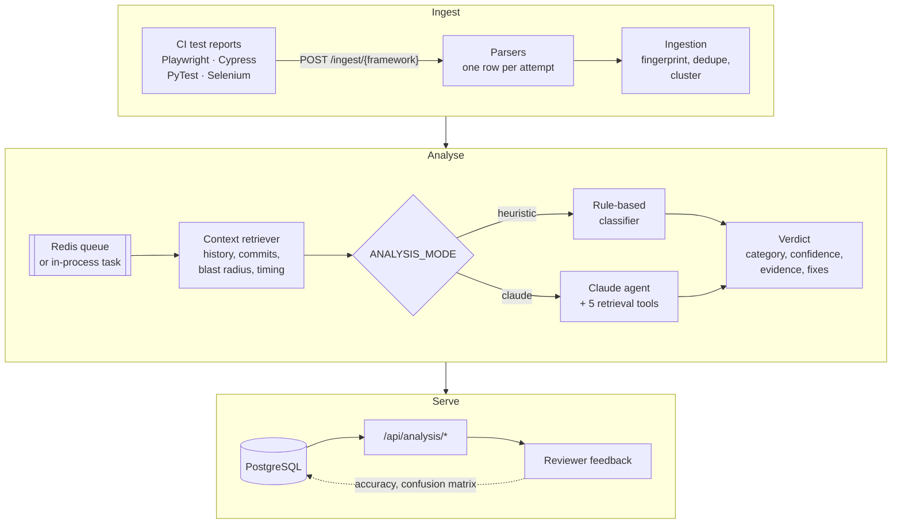
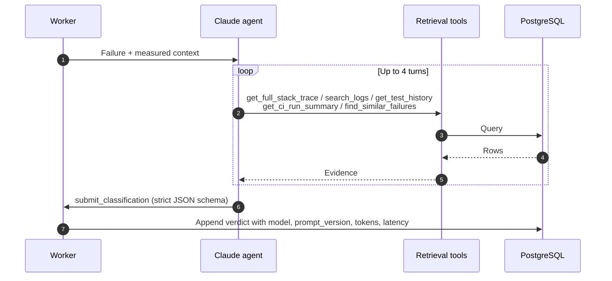
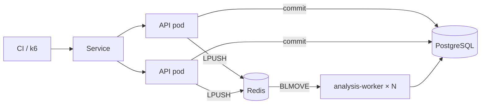
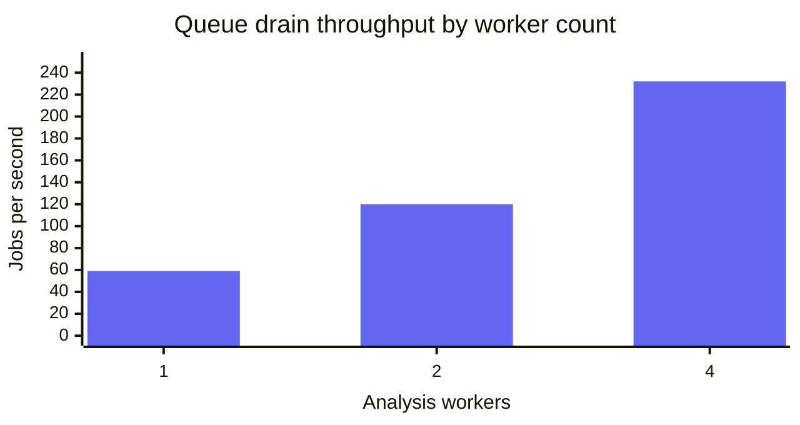

<div align="center">

# Test Observability + AI Root-Cause Agent

**Collects test results from Playwright, Cypress, PyTest and Selenium, and tells you *why* each failure happened.**

[](https://github.com/AtharvaK14/Test-Observability-AI-Root-Cause-Agent/actions/workflows/ci.yml)


[](https://github.com/astral-sh/ruff)
[](LICENSE)

[Features](#features) · [How it works](#how-it-works) · [Quick start](#quick-start) · [API](#api) · [Performance](#performance) · [Setup guide](docs/SETUP.md)

</div>

---

CI goes red and all you get is something like `Timeout 30000ms exceeded`. That
one message can come from an app hang, a missing wait, a starved runner or a
dead downstream service. This service collects the evidence an engineer would
check (test history, commit range, what else failed in the run, timing against
the passing baseline) and hands it to a classifier. That classifier is either a
Claude agent or a rule-based engine, and it picks one of seven root causes,
lists the evidence behind the choice and suggests next steps.

## Features

- **Four frameworks, one schema.** Parsers for Playwright, Cypress (module API, mochawesome, mocha), PyTest (`pytest-json-report`) and Selenium (JUnit/TestNG XML), plus any JUnit XML.
- **Retry-aware ingestion.** Each retry attempt gets its own row, so a test that fails and then passes is stored as `FLAKY` instead of disappearing into a green build.
- **Evidence-first context.** Run history, last-pass vs first-fail commit, CI-run blast radius, duration vs baseline, signature spread and host metrics. Missing data is marked unavailable, never invented.
- **Claude agent with tools.** The agent can pull stack traces, grep logs and check sibling tests before it submits a verdict through a strict, schema-validated tool call.
- **Rule-based classifier.** No API key, no network, zero cost. Doubles as the baseline the agent is measured against.
- **Deterministic clustering.** Normalised error fingerprints group hundreds of red tests into the handful of problems behind them. Known issues can be muted.
- **Flakiness and trend verdicts.** Every test is graded healthy, flaky, broken, degrading or unreliable from its run history.
- **Feedback loop.** Reviewers record the correct category, which feeds accuracy, a confusion matrix, token spend and latency on `/api/analysis/metrics`.
- **Horizontal scale.** Optional Redis queue with separately scaled workers, load-tested on Kubernetes with k6.
- **Built-in eval harness.** 27 cases, 11 of them taken from real CI failures, scored for accuracy, grounding, consistency, calibration and prompt-injection resistance.

## How it works



### What the classifier looks at

| Signal | Source | What it tells you |
|---|---|---|
| Run history | Last 30 runs: pass rate, streak | A long green streak then red means something changed. Alternating for weeks means the test. |
| Commit range | Last passing vs failing commit | Passed and failed on the same commit: not a regression. |
| Blast radius | Other failures in the same CI run | Failures across different frameworks point at the app or the environment, not the tests. |
| Duration | This run vs the passing baseline | Burned the full timeout means it was waiting. Died in 200 ms means something was missing. |
| Signature spread | Normalised error fingerprint across all tests | One signature in unrelated tests means one shared cause. |
| Host metrics | CPU, memory, disk I/O, network latency, when the runner sends them | A runner at 98% CPU explains a timeout that reading the test never will. |

### The agent loop



Analyses are append-only, so verdicts from different prompt versions or models
can be compared on the same failures.

### Root-cause categories

| Category | Owner | Typical action |
|---|---|---|
| 🐞 `app_bug` | Dev team | File a defect. The test did its job. |
| 🎲 `flaky_test` | Test author | Fix the wait, locator or ordering. The app is fine. |
| 🌐 `environment` | Platform team | Check deploys and service health. |
| 🗃️ `test_data` | Test author | Refresh the fixture or seed data. |
| 🖥️ `infrastructure` | CI platform | Runner OOM, disk, permissions, image drift. |
| 🔌 `external_dependency` | Third party | Stub it or add a readiness gate. |
| ❓ `unknown` | Reviewer | Not enough evidence. Flagged for review instead of guessed. |

### Example verdict

A Playwright test and a PyTest test failed with the same error in one CI run.
Below is one item from `GET /api/analysis/failures`, trimmed. It comes from the
demo dataset with the rule-based classifier.

```json
{
  "test": {
    "test_name": "search.spec.ts > returns results for a known term",
    "framework": "playwright",
    "status": "failed",
    "error_message": "Error: connect ECONNREFUSED 10.0.4.19:9200 (search-index)",
    "ci_run_id": "seed-run-023"
  },
  "analysis": {
    "root_cause": "environment",
    "confidence_score": 0.78,
    "key_evidence": [
      "matched connectivity signal: 'ECONNREFUSED'",
      "1 test(s) in other frameworks failed with the identical error signature in this CI run"
    ],
    "suggestions": [
      "Check service health and deploy events for this environment at this time",
      "Confirm the dependency was reachable from the CI network",
      "Consider a readiness gate before the suite starts"
    ],
    "requires_human_review": false,
    "model": "heuristic-v1"
  }
}
```

### Flakiness and trends

Flakiness is scored as **instability**: the share of consecutive runs whose
outcome flipped. A test that fails every time is broken, not flaky.

| Daily results, oldest to newest | Pass rate | Instability | Verdict |
|---|:---:|:---:|:---:|
| ✅✅✅✅✅✅✅✅✅✅ | 100% | 0.00 | **healthy** |
| ✅❌✅❌✅❌✅❌✅❌ | 50% | 1.00 | **flaky** |
| ❌❌❌❌❌❌❌❌❌❌ | 0% | 0.00 | **broken** |
| ✅✅✅✅✅✅✅❌❌❌ | 70% | 0.11 | **degrading** |

## Quick start

Runs the whole pipeline on SQLite with the rule-based classifier. No API key,
no Docker, no database to install.

```bash
python -m venv .venv
source .venv/bin/activate              # Windows: .venv\Scripts\activate
pip install -r requirements-dev.txt
cp .env.example .env                   # defaults work as is

python scripts/seed_demo.py --reset    # 3 weeks of history, 10 planted failures
uvicorn backend.main:app --reload      # terminal 1
python scripts/analyze_pending.py      # terminal 2: classify every failure
```

Open <http://localhost:8000/docs> for the interactive API. New to Python
tooling? [docs/SETUP.md](docs/SETUP.md) walks through every step on Windows,
with troubleshooting.

**Use Claude:** set `ANTHROPIC_API_KEY` and `ANALYSIS_MODE=claude` in `.env`.

### Run it your way

| Target | Command | What you get |
|---|---|---|
| Local | `uvicorn backend.main:app` | SQLite, in-process analysis |
| Docker Compose | `docker compose up --build` | API + PostgreSQL |
| Kubernetes (kind) | `./k8s/deploy.sh` | 2 API replicas, PostgreSQL, Redis, N analysis workers |
| AWS | `deploy/up.sh` | ECS Fargate + RDS, deployed by GitHub Actions over OIDC. See [deploy/README.md](deploy/README.md) |

### Send a report from CI

```bash
curl -X POST http://localhost:8000/ingest/playwright \
  -H "X-API-Key: $API_KEY" \
  -F "file=@playwright-report.json" \
  -F "ci_run_id=$GITHUB_RUN_ID" \
  -F "git_commit=$(git rev-parse HEAD)" \
  -F "git_branch=$(git rev-parse --abbrev-ref HEAD)"
```

The `X-API-Key` header is only checked when `API_KEY` is set (it is required in
staging and prod). A ready-to-use GitHub Actions workflow is in
[ci/github-actions/ingest-test-results.yml](ci/github-actions/ingest-test-results.yml).

## API

**Ingest**

| Endpoint | Accepts |
|---|---|
| `POST /ingest/playwright` | `playwright test --reporter=json` |
| `POST /ingest/cypress` | Module API, mochawesome or mocha JSON (auto-detected) |
| `POST /ingest/pytest` | `pytest --json-report` |
| `POST /ingest/selenium` | JUnit/TestNG XML or normalised JSON |
| `POST /ingest/junit?framework=…` | Any JUnit XML |
| `POST /ingest/results` | Pre-normalised JSON body |

Every upload reports `ingested`, `skipped_duplicates`, `failures_detected`,
`analyses_queued` and per-entry warnings.

**Analysis**

| Endpoint | Returns |
|---|---|
| `GET /api/analysis/summary` | Counters, root-cause distribution, framework breakdown |
| `GET /api/analysis/failures` | Paginated failures with verdicts, filterable by framework, root cause, review status |
| `GET /api/analysis/failures/{id}` | One failure with every verdict, its cluster and its CI-run siblings |
| `GET /api/analysis/tests/{name}/trends` | Daily pass rate and a health verdict |
| `GET /api/analysis/flaky` | Flakiness leaderboard |
| `GET /api/analysis/clusters` | Recurring failure patterns, largest first |
| `GET /api/analysis/metrics` | Accuracy, confusion matrix, token spend, latency |
| `GET /api/analysis/queue` | Failures waiting for analysis |
| `POST /api/analysis/analyses/{id}/feedback` | Record a reviewer's verdict |
| `POST /api/analysis/clusters/{id}/mute` | Acknowledge a known issue and stop re-analysis |

## Performance

Load-tested with k6 on a local kind cluster: 2 API replicas, PostgreSQL, Redis
and a separately scaled analysis worker.



| | In-process analysis | Redis queue, 4 workers |
|---|:---:|:---:|
| Ingest throughput | 54 to 64 req/s | **161 to 171 req/s** |
| Ingest latency p50 | 250 to 257 ms | **13 to 20 ms** |
| Failed requests | 0 | 0 |
| Lost counter updates | 0 | 0 |



Drain throughput scales close to linearly with workers. A worker killed mid-job
has its claimed jobs requeued within 13 s. All runs, the three concurrency bugs
the test uncovered and how to reproduce it are in
[docs/load-test-results.md](docs/load-test-results.md).

## Evaluation

The eval harness in [evals/root_cause](evals/root_cause/README.md) replays real
CI history through the production ingest path and grades verdicts without an
LLM judge. CI runs the free offline modes on every pull request and every push
to `main`.

| Case source | Cases | Rule-based baseline |
|---|:---:|:---:|
| Real CI failures | 11 | 55% (95% CI: 28% to 79%) |
| Prompt-injection variants | 6 | 67% |
| Synthetic (harness check only) | 10 | 100% by construction |

The Claude agent has not been run against this set yet. Live runs are gated
behind a reviewed harness approval and a hard spend budget.

## Project structure

```
backend/
├── api/          REST routes: ingest (write) and analysis (read)
├── ingest/       Per-framework parsers and the ingestion service
├── analysis/     Context retriever, Claude agent, rule-based classifier, clustering
├── db/           SQLAlchemy models, sessions, repositories
├── models/       Pydantic schemas and shared enums
├── worker.py     Redis queue consumer
└── tests/        217 tests: in-memory SQLite, stubbed Claude client, fakeredis
evals/            Root-cause eval harness, cases and grading
scripts/          seed_demo, analyze_pending, score_classifier, dump_schema
k8s/              kind manifests and deploy script
loadtest/         k6 script and in-cluster runner
deploy/           AWS scripts and IAM policies
ci/               Dockerfile and example ingest workflow
db/               Generated schema.sql and Alembic migrations
docs/             Setup guide and load-test results
```

## Development

```bash
pytest                                          # 241 tests, no network, no API key
mypy                                            # strict
ruff check backend/ scripts/ evals/
python scripts/dump_schema.py > db/schema.sql   # after any model change
```

CI runs lint, type checks and tests on Python 3.11 and 3.13, checks that
`db/schema.sql` matches the ORM, runs the offline eval and builds the Docker
image.

<details>
<summary><b>Configuration</b></summary>

<br>

All settings live in [.env.example](.env.example). The main ones, with the
values it ships with:

| Variable | `.env.example` | Purpose |
|---|---|---|
| `ANALYSIS_MODE` | `heuristic` | `heuristic` (rules, free) or `claude` (agent) |
| `ANTHROPIC_API_KEY` | unset | Required for `claude` mode |
| `ANTHROPIC_MODEL` | `claude-opus-5` | Model the agent uses |
| `ANTHROPIC_EFFORT` | `high` | `low`, `medium`, `high`, `xhigh` or `max` |
| `AGENT_MAX_ITERATIONS` | `4` | Tool-use turns before a verdict is forced |
| `AUTO_ANALYZE_ON_INGEST` | `true` | Analyse on upload, or on demand only |
| `DATABASE_URL` | SQLite file | `postgresql+psycopg://…` in production |
| `REDIS_URL` | unset | Set to move analysis onto the Redis queue |
| `API_KEY` | unset | Shared key for every route, required in staging and prod |
| `GIT_REPO_PATH` | unset | Checkout of the app under test, for real commit metadata |

</details>

## Roadmap

- [x] Parsers for Playwright, Cypress, PyTest and Selenium
- [x] Rule-based classifier and Claude agent
- [x] Clustering, flakiness scoring and trend verdicts
- [x] Redis queue, Kubernetes manifests and load test
- [x] Offline eval harness in CI
- [ ] Web dashboard
- [ ] Live Claude run against the eval set
- [ ] Per-client API keys with scopes and rotation
- [ ] Embedding-based similarity for near-duplicate failures

## License

Released under the [MIT License](LICENSE). Copyright (c) 2026 Atharva Kadam.
